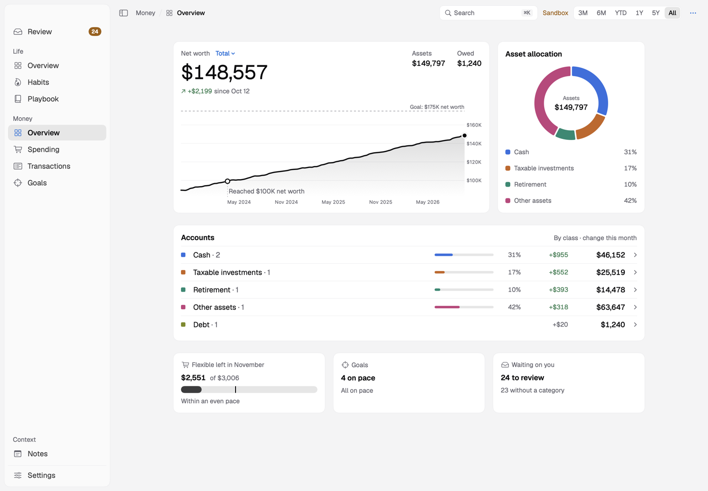
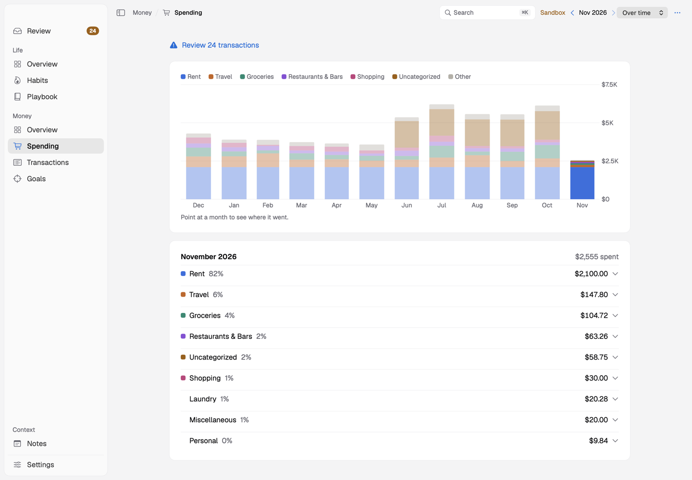
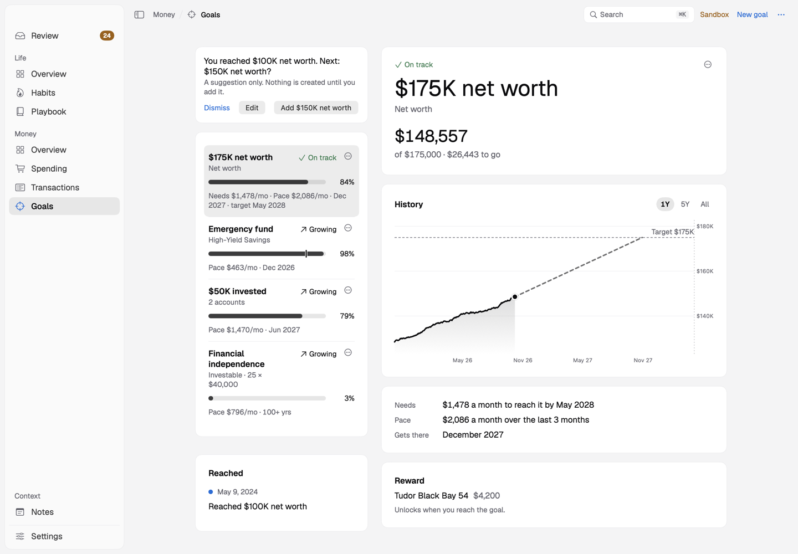
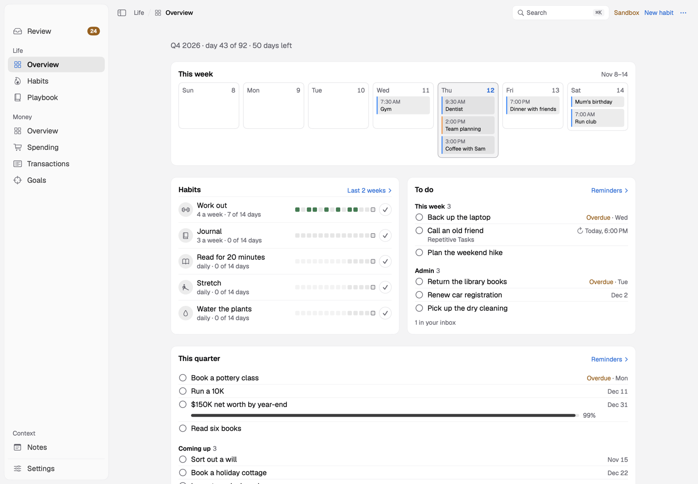

# Compass

A personal, local-first Mac app for money and life plans. Compass tracks net worth, accounts, goals, spending and a budget, and alongside them habits, your calendar and the lists you keep in Apple Reminders. It was built to replace Monarch Money for one person.

Everything stays on your Mac: no hosted service, no Compass account, no analytics. All amounts are in US dollars.



## What it does

- **Money.** Net worth over time, in total, by account class or month by month, with asset allocation and every account's history. Accounts sync from your banks through [SimpleFIN Bridge](https://beta-bridge.simplefin.org), or you enter them by hand.
- **Review.** New transactions wait for a quick look. Compass learns a category for each merchant, spots transfers between your own accounts, and offers to refile a merchant's other charges when you change one.
- **Spending.** One flexible monthly budget beside fixed bills, a pace meter, twelve months of history, and a starting budget built from your past spending.
- **Goals.** Net worth, account-group and financial-independence goals, each with a pace, a projection, and an optional reward when you reach it.
- **Life.** The week's calendar, habit streaks, Reminders' lists for this week, admin and this quarter, a vision with yearly bets, a Playbook of routines and picks, and notes.
- **Claude access (optional, off by default).** A local MCP endpoint lets Claude read your figures and, with your confirmation in the chat, make changes you can undo.

| Spending | Goals | Life |
| --- | --- | --- |
|  |  |  |

The screenshots use the made-up demo data (`--seed-demo`).

## Privacy

- Your data lives in a SwiftData store inside the app's sandbox container. The SimpleFIN access and the Claude endpoint key live in the Keychain.
- The only network requests are bank sync and optional merchant-logo fetching (by website domain).
- Compass can lock when it opens or after sleep and idle, unlocking with Touch ID or your Mac password. Hide Amounts (⌘⇧H) blanks every figure.
- Daily JSON backups are kept for two weeks. See [SECURITY.md](SECURITY.md) for the full model.

## Build and run

You need macOS 26, Xcode and [XcodeGen](https://github.com/yonaskolb/XcodeGen).

```bash
brew install xcodegen
xcodegen                                  # generates Compass.xcodeproj from project.yml
open Compass.xcodeproj                    # run the "Compass Sandbox" scheme
cd Core && xcrun swift test               # the logic and its tests
```

The **Compass Sandbox** scheme runs a separate debug app, Compass Dev, with its own store and Keychain entries, so it never touches real data. Launch it with `--seed-demo` for three years of made-up history. Builds are ad hoc signed by default; to sign with your own team, copy `Config/Local.xcconfig.example` to `Config/Local.xcconfig`.

## Documentation

| Read | For |
| --- | --- |
| [docs/USING.md](docs/USING.md) | Every screen in detail, where the data comes from, how categories are assigned, installing a Release build |
| [docs/ARCHITECTURE.md](docs/ARCHITECTURE.md) | How the code fits together and where things belong |
| [docs/DEVELOPING.md](docs/DEVELOPING.md) | Debug launch options, export formats, Claude's endpoint, signing |
| [docs/TESTING.md](docs/TESTING.md) | How the logic is tested |
| [docs/DESIGN.md](docs/DESIGN.md) · [docs/PERFORMANCE.md](docs/PERFORMANCE.md) | Design rules and performance caps for any change |
| [docs/SPEC.md](docs/SPEC.md) · [docs/DECISIONS.md](docs/DECISIONS.md) · [docs/HISTORY.md](docs/HISTORY.md) | Scope, product decisions and how Compass got here |
| [CLAUDE.md](CLAUDE.md) | The code map and working rules (also loaded by coding agents as AGENTS.md) |

## Contributing

Bug fixes and polish are welcome; for anything larger, open an idea issue first. Compass stays a single-user, local, USD, macOS app. See [CONTRIBUTING.md](CONTRIBUTING.md), and report security problems privately as [SECURITY.md](SECURITY.md) describes.

## Licence

[MIT](LICENSE). Bundled fonts are under the SIL Open Font License; see [THIRD_PARTY.md](THIRD_PARTY.md).
